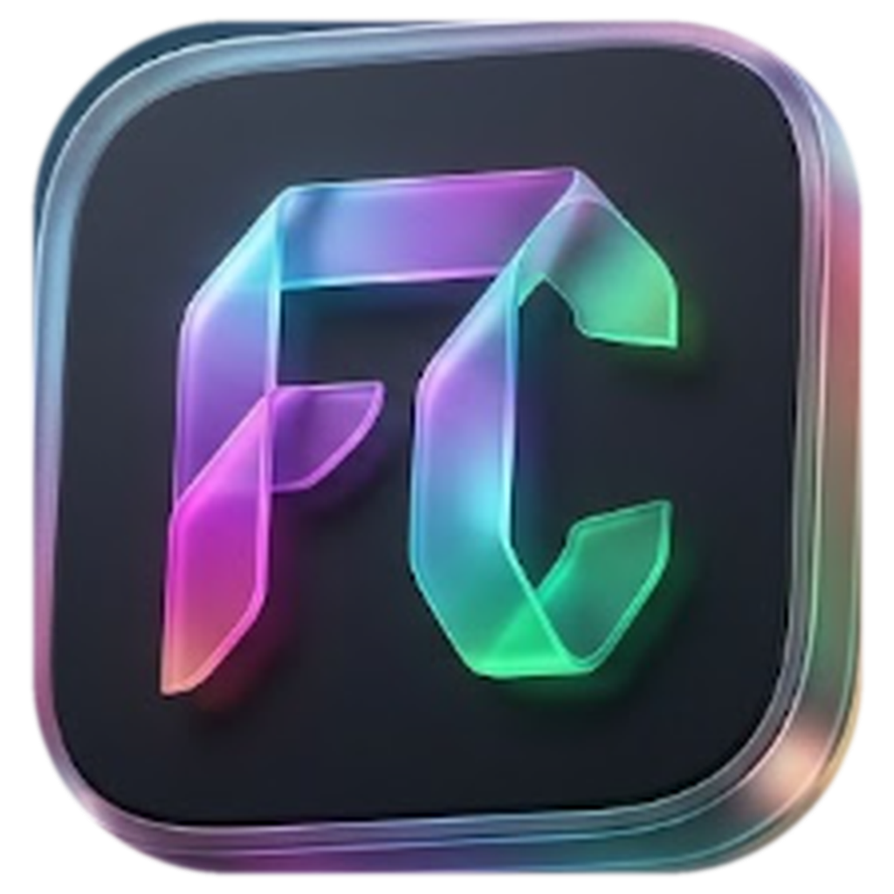
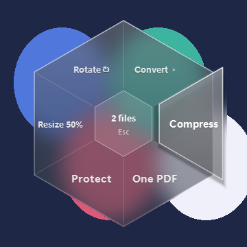

# FC (File Converter)



A free tool for **Windows and Linux** that converts, compresses and edits files from a glass octagon
on your screen. Drop files on it, pick **Choose files**, or (Windows) select files in File Explorer
and press **Ctrl+Alt+C** (or hold **Shift** and scroll): the octagon turns into the tools for those files.
Before a tool runs it asks where to save the result. Your original file is never overwritten.

**FC never connects to the internet by itself.** Every tool runs on your own computer. The one exception is
**Scan › Virus check**, which you start yourself: it computes the file's SHA-256 here and opens that hash's
[VirusTotal](https://www.virustotal.com) page in your browser. The file itself is never uploaded.

## Download and verify
1. Open the [latest release](https://github.com/hassanaldajah/FC/releases/latest) and download
   `FC-<version>-win64-setup.exe` (Windows) or `FC-<version>-x86_64.AppImage` (Linux) and its `.sha256` file.
2. Check the checksum (Windows, PowerShell; on Linux use `sha256sum -c FC-<version>-x86_64.AppImage.sha256`). The two values must be the same:
   ```powershell
   (Get-FileHash .\FC-2.1.0-win64-setup.exe -Algorithm SHA256).Hash.ToLower()
   Get-Content .\FC-2.1.0-win64-setup.exe.sha256
   ```
3. Optional, stronger: prove the file was built by this repository's GitHub Actions from the
   tagged source code (needs the free [GitHub CLI](https://cli.github.com/)):
   ```powershell
   gh attestation verify .\FC-2.1.0-win64-setup.exe --repo hassanaldajah/FC
   ```
4. Optional: scan the download on [VirusTotal](https://www.virustotal.com) (use **Scan › Virus check** in FC,
   or upload it there). Unsigned programs packed with PyInstaller sometimes get a lone false positive
   from one engine; steps 2 and 3 prove the file is exactly what this repository's source builds.

### Windows
Run `FC-<version>-win64-setup.exe`. It installs FC for your user only (no administrator prompt) into
`%LOCALAPPDATA%\Programs\FC`, adds a Start menu entry and, if you tick it, a Desktop shortcut. It replaces
FC 1.x in place. Remove FC under *Settings › Apps*. FC 2.1 opens in about a second; the old single
`FC-1.x-win64.exe` had to unpack itself on every start, which took 10 seconds or more.

### Linux
```sh
chmod +x FC-2.1.0-x86_64.AppImage && ./FC-2.1.0-x86_64.AppImage
```
- Runs on 64-bit Linux with glibc 2.35 or newer. Every release is tested automatically on Ubuntu 22.04, 24.04 and
  26.04, Linux Mint 21 and 22, Debian 12 and 13, Kali, Fedora 43 and 45, AlmaLinux 10, Arch, Manjaro,
  openSUSE Tumbleweed and Leap 16 (and on distributions based on these, such as Pop!_OS, Zorin and elementary).
  On older systems (Ubuntu 20.04, Debian 11, RHEL/AlmaLinux 9, openSUSE Leap 15) and on musl systems such as
  Alpine it shows a message saying so instead of starting.
- Nothing to install first: the libraries Qt needs (`libxcb-cursor0` and the like) are inside the AppImage, and
  it needs no `libfuse2`.
- The first time you open it, FC offers to install itself: it copies the AppImage to `~/.local/share/FC` and, as
  you choose, adds it to the applications menu and the Desktop. Choose **Just run** to skip it, or tick
  *Don't ask again*. To remove FC later, delete that folder, `~/.local/share/applications/FC.desktop` and the
  Desktop icon.
- Uses X11, or XWayland inside a Wayland session (GNOME and KDE have it). Ctrl+Alt+C works on X11 only, and under
  Wayland the glass shows no desktop blur.
- Word, Excel and PowerPoint conversions (and splitting Word) use **LibreOffice** if installed
  (`sudo apt install libreoffice`); merging, protecting and watermarking Office files need Windows with
  Microsoft Office, so those sides are hidden on Linux. Scanning uses `scanimage` (`sane-utils`).

### "Windows protected your PC"
The exe is not code-signed (a signing certificate costs money every year, and this project is free).
Windows SmartScreen therefore warns about any new unsigned program until enough people have run it.
If the checksum above matches, click **More info → Run anyway**. You only need to do this once.

## What it does
| Files | Sides of the octagon (› opens more tools) |
|---|---|
| Start | Choose files, Scan › (Virus check, Paper scan), Recent ›, PDF, Images, Office, Media, Other files |
| PDF | Split / Merge, Convert › (Word, JPG, PNG, PowerPoint, Text, Get images), Compress, Pages ›, Security ›, Edit › (watermark, page numbers, repair), Zip |
| Word / PowerPoint | Convert ›, Compress, Split / Merge, Protect, Watermark, Lock in ZIP, Zip |
| Excel | Convert ›, Compress, Split / Merge, Protect, Zip, Lock in ZIP |
| Images | Convert ›, Compress, Split in 4 / One PDF, Protect, Edit › (watermark, resize, rotate), Zip, Lock in ZIP |
| Audio / video | Convert ›, Compress, Split / Merge, Lock in ZIP, Zip |
| Anything else | Zip, Lock in ZIP (AES-256, opens with 7-Zip or WinRAR) |

- **Scan › Paper scan** uses the scanner Windows already knows (WIA): Windows' own scan window opens, the page is
  saved as a PNG, and the octagon offers the image tools (for example Convert › PDF).
- **Recent › Compare** shows a before / after card with both sizes and the change in percent.
- **Recent › Versions** opens the hidden `.fc-versions` folder: `v0` is the original, then one
  version per result, so you can always go back.

Keys: arrows or the mouse wheel move around the sides, Enter picks, 1-8 pick directly, Tab also
reaches the centre and the – / × buttons, Esc closes, Backspace goes back. Drag the centre to move it.
With Windows' "Animation effects" setting off, the octagon appears without motion.

## Safety
- Word, Excel and PowerPoint files are opened with macros turned off and links not refreshed.
- Files that unpack to more than 2 GB (zip bombs) and inputs over 4 GB are refused.
- Found a security problem? See [SECURITY.md](SECURITY.md).

## Run from source
```powershell
py -m venv .venv
.venv\Scripts\python -m pip install --require-hashes -r requirements.txt
.venv\Scripts\pythonw fc.py
```
Linux: `python3 -m venv .venv && .venv/bin/python -m pip install --require-hashes -r requirements.txt && .venv/bin/python fc.py`.
On Windows the Office tools need Microsoft Office installed. `requirements.in` lists the direct dependencies;
`requirements.txt` pins every package with its hashes (rebuild it with `tools\lock.py`).

## Build it yourself
```powershell
.venv\Scripts\python -m pip install --require-hashes -r requirements-build.txt
.venv\Scripts\python -m PyInstaller --clean --noconfirm fc.spec
dist\FC\FC.exe --selftest
ISCC.exe /DVersion=2.1.0 packaging\windows\FC.iss
```
The result is the folder `dist\FC`, which [Inno Setup](https://jrsoftware.org/isinfo.php) (free) turns into
`dist\FC-<version>-win64-setup.exe`. On Linux, `packaging/linux/build-appimage.sh <version>` wraps `dist/FC`
into an AppImage. `FC --selftest` runs every tool on sample files and opens the octagon; the results are also
written to `selftest.txt` in FC's log folder. Releases are built and tested the same way by
[.github/workflows/release.yml](.github/workflows/release.yml) when a `v*` tag is pushed; *Run workflow*
builds and tests a branch without publishing.

Icons: [Lucide](https://lucide.dev) (ISC licence, see `icons/LICENSE-lucide.txt`).
